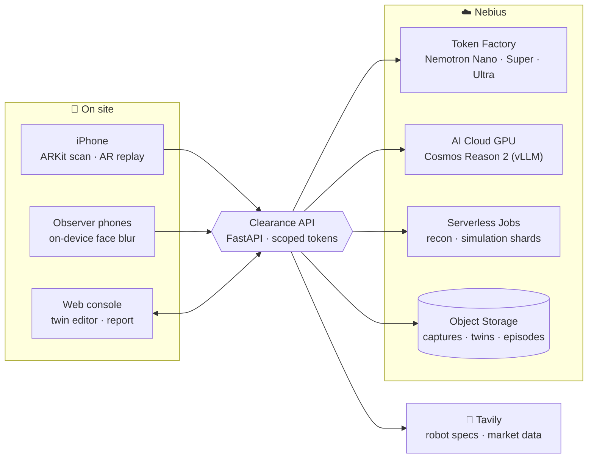

# Clearance: Know if a robot fits before you buy it

**Scan a real room with an ordinary iPhone. Clearance builds a measured digital twin, finds which commercial delivery robots and AMRs can actually work there, simulates them against real foot traffic, and tells you what to buy, what to move, and what it pays back. Every number is traceable to a simulation run, a measurement, or a cited source.**

Built for the **Nebius x NVIDIA Global AI Hackathon**, Physical AI track, with **NVIDIA Nemotron**, **Nebius Token Factory**, **Nebius AI Cloud**, **Cosmos Reason 2** for scene understanding, and **Tavily** for live robot research.

[](https://github.com/vivekyarra/Clearance/actions/workflows/ci.yml)
[](https://github.com/vivekyarra/Clearance/actions/workflows/ios.yml)


---

## Why

Cafés, restaurants, clinics and small warehouses are being sold service robots and AMRs. Whether a robot works depends on *this* site: aisle widths, turning space, door lips, clutter, and people at peak hours. Today the answer comes from a vendor visit or a paid pilot. Clearance gives the owner an independent answer from a 5-minute phone scan.

## What it does

1. **Scan.** The Clearance iPhone app captures ARKit poses and keyframes, anchored to a floor marker. Faces are blurred on the phone. Android phones can join as fixed observers that record foot traffic (also blurred on device).
2. **Twin.** The server fuses depth (LiDAR, or Depth Anything V2 Small aligned to ARKit feature points on non-LiDAR phones) into a 2.5 cm occupancy grid with furniture primitives, door thresholds and hazards.
3. **Edit.** The operator places the dock, pickup and delivery stops in the twin editor and fixes any labels.
4. **Clearance check.** Code filters the robot catalog, checks static feasibility on three geometry bounds, and runs Monte Carlo navigation batches with pedestrians. **Nemotron 3 Super** then investigates every failure with real experiments in the simulator. A layout optimizer searches for furniture moves that help.
5. **Verdict.** Each robot gets exactly one code-decided verdict: **Cleared**, **Cleared with changes**, or **Not cleared**, with the rule that produced it.
6. **Clearance Report.** **Nemotron 3 Ultra** writes the narrative around code-rendered tables; a fact-checker verifies that every number carries a fact tag that matches its source.
7. **AR replay.** Point the iPhone at the marker and watch the chosen robot drive the mission in the real room, hidden behind real furniture, stopping for real people.

## Measured results

| What | Result | Source |
|---|---|---|
| **Real room, iPhone 13 (no LiDAR)**, scan vs tape measure, 8 distances | **median error 1.0 cm**, p90 3.0 cm, max 4.0 cm | on-site tape check, `docs/EVAL.md` |
| **Real-room Clearance check** (5 café robots, 100 episodes per batch) | DINERBOT T8 **Cleared**: 100% / 99% / 95% success at quiet / normal / peak traffic; 4 robots Not cleared with the exact pinch point | `docs/EVAL.md` |
| Reference rooms, LiDAR tier, 60 distances | median 1.2 cm | `docs/GATE.md` |
| Reference rooms, camera-only tier, 60 distances | median 0.9 cm | `docs/GATE.md` |
| Go/no-go gate (scan to occupancy) | **GO** on reference rooms and on a real room | `docs/GATE.md` |
| Robot catalog | 12 real robots, every numeric spec backed by a verbatim quote from its source page | `catalog/README.md` |
| Live robot research | Tavily Search + Extract + Nemotron extraction: 129 fields validated, 60 rejected by the quote validator | `catalog/README.md` |
| **Nemotron on Nebius Token Factory**, 3 full reference checks | 90 live calls (39 Super, 51 Ultra), 0 failed, median 2.5 s / 6.9 s per call, about 0.58 USD at list price | `docs/PROOF.md` |
| Fact-checked reports | 100% of numbers in published Clearance Reports carry a valid fact tag | `docs/EVAL.md` |
| Automated tests | 2,700+ Python tests, 83 web tests, 94 Swift tests, all green in CI | GitHub Actions |

Verdicts on the three reference sites, investigation statistics, wall times and simulation throughput are in [`docs/EVAL.md`](docs/EVAL.md). Live model usage is in [`docs/PROOF.md`](docs/PROOF.md).

## How we use NVIDIA and Nebius

| Component | Role in Clearance | Status |
|---|---|---|
| **Nebius Token Factory** | OpenAI-compatible inference for every Nemotron call. Model IDs are confirmed from `GET /v1/models` by `scripts/verify_token_factory.py` and recorded in `config/models.yaml`. | Integrated (`config/models.yaml`, `agents/llm/client.py`) |
| **Nemotron 3.5 Lightning (Nano tier)** | Turns Tavily-extracted datasheet text into structured robot specs, one verbatim quote per field. | Live |
| **Nemotron 3.5 Super VL (Super tier)** | Orchestrator and **investigation loop**: forms a hypothesis about why a robot fails, chooses the next experiment (fewer pedestrians in a zone, a chair moved, a different robot), runs it through the simulator tools, reads the result, and decides whether to dig further. Capped at 6 experiments per robot. | Live |
| **Nemotron 3 Ultra (Ultra tier)** | Writes the Clearance Report narrative from the facts pack and the investigation trail. | Live |
| **Cosmos Reason 2** (self-hosted on Nebius AI Cloud via vLLM) | Scene understanding: hazards such as cables, glass partitions and door swings, from keyframes plus the detected object list. It never outputs geometry. | Deployment-ready (`infra/nebius/deploy_vision_endpoint.sh`) |
| **Nebius AI Cloud / Serverless Jobs** | Reconstruction and splat jobs on GPU; simulation shards as parallel CPU jobs (`infra/jobs/`, `infra/nebius/`). | Deployment-ready (`infra/`) |
| **Nebius Object Storage** | Captures, twins and episodes (S3-compatible, presigned uploads). | Integrated (`services/api/store.py`) |

Language models never produce measurements or verdicts. All numbers come from code; Nemotron plans, investigates, explains and writes.

## How we use Tavily

Tavily is load-bearing in two places:
- **Catalog builder:** Tavily Search finds datasheets and spec pages, Tavily Extract pulls their text, Nemotron extracts each field with a quote, and a validator accepts a value only if the quote appears verbatim on the page and contains the number. Fields without proof stay empty. Prices are taken only from public pages ("price on request" otherwise).
- **Live market check:** each Clearance check can pull current public pricing, deployment reviews and safety-standard references, all cited in the report.

## Architecture

```mermaid
flowchart LR
    A["Capture"] --> B["Depth + fusion"] --> C["2.5 cm occupancy twin"] --> D["Twin editor"]
    D --> E["Feasibility<br/>3 geometry bounds"] --> F["Monte Carlo<br/>with pedestrians"]
    F --> G["Nemotron<br/>investigation loop"] --> H["Layout optimizer"]
    H --> I["Code verdicts"] --> J["Facts pack"] --> K["Clearance Report<br/>fact-checked"] --> L["AR replay"]

    classDef model fill:#76b900,stroke:#4a7a00,color:#fff
    classDef code fill:#1f6feb,stroke:#0b3d91,color:#fff
    class G,K model
    class E,F,I,J code
```





Green steps are Nemotron on Nebius Token Factory; blue steps are deterministic code that decides every number and verdict.

Details: [`docs/ARCHITECTURE.md`](docs/ARCHITECTURE.md), data contracts in [`clearance_core/schemas.py`](clearance_core/schemas.py) and [`schemas/`](schemas/).

## Try it

The repo ships three reference sites (café, storeroom, corridor) with recorded Clearance checks, so the console works without a scan.

```bash
pip install -r requirements.txt
cd apps/web && npm ci && npm run build && cd ../..
PYTHONPATH=. python -m uvicorn services.api.main:app --port 8000 --ws-max-size 131072
```

Open http://localhost:8000. Without keys, Clearance runs in offline mode with a deterministic policy in place of the language models. For live runs, copy `.env.example` to `.env` and set `NEBIUS_API_KEY` and `TAVILY_API_KEY`.

**iPhone app:** CI builds an unsigned `.ipa` on every change (`iOS` workflow artifact). Install it with Sideloadly, or build from `apps/ios` with XcodeGen and Xcode 16. See [`apps/ios/README.md`](apps/ios/README.md).

**Scan a real room:** create a site in the console, print the marker (or open `/screen-marker.html` on a second phone and lay it flat), join with the iPhone app through the site QR code, scan, then place stops in the editor and press **Run Clearance check**.

**Reproduce the proof:** `python scripts/release_proof.py --require-provider token_factory --fresh-usage` re-runs the reference checks live on Nebius Token Factory and rebuilds `docs/PROOF.md`.

## Repository

| Path | What |
|---|---|
| `apps/ios` | Swift app: capture, upload, AR replay (`ClearanceKit` unit-tested in CI) |
| `apps/web` | React console, twin editor, Clearance Report, replay, observer page, joystick |
| `services/api` | FastAPI service: sites, captures, twins, checks, live sessions, auth |
| `jobs/recon`, `jobs/semantics`, `jobs/traffic`, `jobs/splat` | Twin building, objects and hazards, foot traffic, Gaussian splats |
| `jobs/sim`, `jobs/optimizer` | Navigation simulator and layout optimizer |
| `agents/` | Nemotron client, orchestrator, investigation loop, report writer, fact-checker, catalog builder |
| `clearance_core` | Shared data contracts, grid I/O, code-decided verdicts |
| `catalog/robots` | Robot specs with sources |
| `sample_sites` | Reference sites with recorded Clearance checks |
| `infra` | Dockerfiles, Nebius job and endpoint definitions |
| `docs` | Plan, architecture, evaluation, proof, privacy, verification notes |

## Scope

Clearance covers wheeled service and delivery robots (Class A) and indoor AMRs (Class B) on point-to-point delivery missions on one floor. Humanoids, manipulation, outdoor sites, stairs and elevators are outside the current scope. Simulation results are simulation-based estimates, shown as ranges across scan uncertainty with their sample sizes; door thresholds near the scan's noise floor are flagged "measure on site".

## Privacy

Faces are blurred on the phone before any image is saved or uploaded; raw frames never leave the device. Published sites contain only twins, blurred imagery and aggregate traffic. See [`docs/PRIVACY.md`](docs/PRIVACY.md).

## License

Apache-2.0 ([`LICENSE`](LICENSE)). Third-party software and models: [`THIRD_PARTY_LICENSES.md`](THIRD_PARTY_LICENSES.md). Built on NVIDIA Cosmos; Nemotron and Cosmos models are used under their NVIDIA model licenses.
