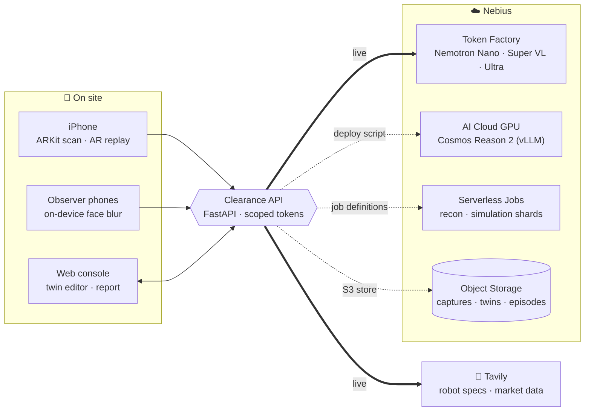

# Clearance

### Know if a robot fits before you buy it.

> Walk your room with an ordinary iPhone. Clearance turns the walk into a measured digital twin (1.0 cm median error against a tape measure), tests every robot that could do the job against your real aisles, doors and foot traffic, and gives each one a verdict decided by code. NVIDIA Nemotron on Nebius Token Factory investigates every failure and writes the report.

Built for the **Nebius x NVIDIA Global AI Hackathon**, Physical AI track.

[](https://github.com/vivekyarra/Clearance/actions/workflows/ci.yml)
[](https://github.com/vivekyarra/Clearance/actions/workflows/ios.yml)


[](https://youtu.be/sYL-GOtZIys)

**▶ [Watch the 3-minute demo video](https://youtu.be/sYL-GOtZIys):** a real room scanned with an iPhone 13, its measured twin, live Nemotron investigations, the verdicts, and the chosen robot driving the route in AR.

**🖥 [Open the Clearance console](https://vivekyarra.github.io/Clearance/):** browse the sites, twins, Clearance checks, investigation trails and reports in your browser. No install, no keys.

## At a glance

| 1.0 cm | 100% / 99% / 95% | 90 / 0 | 2,700+ |
|:-:|:-:|:-:|:-:|
| median scan error in a real room, iPhone 13 with no LiDAR | DINERBOT T8 success in that room at quiet / normal / peak traffic | live Nemotron calls on Nebius Token Factory / failed calls | Python tests, plus 83 web and 94 Swift tests, green in CI |

## The problem

Robots are for sale now. Cafés, hotels, offices and small warehouses are offered delivery robots and AMRs that cost as much as a year of staff time. Whether one works depends on *that* room: aisle widths, turning space, door lips, clutter, and people at peak hours.

Today that answer costs a vendor visit or a paid pilot. Clearance gives an independent answer from a 5-minute phone scan, before you spend a single dollar.

**Who it is for:** cafés, restaurants, hotels, offices and warehouses today. Homes next.

## How it works

1. **Scan.** The Clearance iPhone app records ARKit poses and keyframes, anchored to a floor marker shown on a second phone. Faces are blurred on the phone before anything leaves it. Android phones can join as fixed observers that count foot traffic, also blurred on device.
2. **Twin.** The server fuses depth (LiDAR, or Depth Anything V2 Small aligned to ARKit feature points on phones without LiDAR) into a 2.5 cm occupancy grid with furniture, door thresholds and hazards.
3. **Edit.** The operator confirms the twin, marks the dock, pickup and delivery stops, and runs the check with one click.
4. **Clearance check.** Code filters the robot catalog, checks static feasibility on three geometry bounds, and runs Monte Carlo navigation batches with people walking past. **Nemotron 3.5 Super VL** investigates every failure with real experiments in the simulator. A layout optimizer searches for furniture moves that help.
5. **Verdict.** Each robot gets exactly one verdict, **Cleared**, **Cleared with changes** or **Not cleared**, from a deterministic rule. Nemotron explains verdicts. It never sets them.
6. **Clearance Report.** **Nemotron 3 Ultra** writes the narrative around tables rendered by code. A fact-checker verifies that every number carries a fact tag that matches its source.
7. **AR replay.** Point the iPhone at the marker and watch the chosen robot drive the mission in your real room.

## Measured results

| What | Result | Source |
|---|---|---|
| **Real room, iPhone 13 (no LiDAR)**, scan vs tape measure, 8 distances | **median error 1.0 cm**, p90 3.0 cm, max 4.0 cm | on-site tape check, `docs/EVAL.md` |
| **Real-room Clearance check** (5 café robots, 100 episodes per batch, 202 s end to end) | DINERBOT T8 **Cleared**: 100% / 99% / 95% success at quiet / normal / peak traffic. Bear Servi **Not cleared**: it needs 0.62 m to turn and the gap is 0.52 m. Every verdict names its exact pinch point. | `docs/EVAL.md`, `docs/onsite_clearance_report.md` |
| **Nemotron on Nebius Token Factory**, 3 full reference checks | 90 live calls (39 Super, 51 Ultra), 0 failed, median 2.5 s / 6.9 s per call, about 0.58 USD at list price | `docs/PROOF.md` |
| Nemotron investigation, reference café | moved one chair; Bear Servi success went from 75% to 100% | `docs/EVAL.md` |
| Fact-checked reports | every published number carries a valid fact tag; 0 errors in published reports | `docs/EVAL.md` |
| Rendered reference rooms (sensor noise, pose drift), 60 distances per tier | median 1.2 cm with LiDAR, 0.9 cm camera-only | `docs/GATE.md` |
| Robot catalog | 12 real robots, every numeric spec backed by a verbatim quote from its source page | `catalog/README.md` |
| Automated tests | 2,700+ Python tests, 83 web tests, 94 Swift tests, all green in CI | GitHub Actions |

## Built on NVIDIA and Nebius

**Language models never produce measurements or verdicts.** Every number comes from code. Nemotron plans, investigates, explains and writes, and three Nemotron tiers each have one job.

| Component | Role in Clearance | Status |
|---|---|---|
| **Nebius Token Factory** | OpenAI-compatible inference for every Nemotron call. Model IDs are confirmed from `GET /v1/models` by `scripts/verify_token_factory.py` and recorded in `config/models.yaml`. | **Live** (`docs/PROOF.md`) |
| **Nemotron 3.5 Lightning** (Nano tier) | Turns Tavily-extracted datasheet text into structured robot specs, one verbatim quote per field. | **Live** |
| **Nemotron 3.5 Super VL** (Super tier) | The orchestrator and the **investigation loop**: forms a hypothesis about why a robot fails, chooses the next experiment (fewer people in a zone, a chair moved, a different robot), runs it through the simulator tools, reads the result, and decides whether to dig further. Up to 6 experiments per robot. Also reads keyframes for scene hazards. | **Live** |
| **Nemotron 3 Ultra** (Ultra tier) | Writes the Clearance Report narrative from the facts pack and the investigation trail. | **Live** |
| **Cosmos Reason 2** (vLLM on Nebius AI Cloud) | Dedicated scene-hazard model: cables, glass partitions, door swings. It never outputs geometry. Today Nemotron 3.5 Super VL runs this step live on Token Factory. | One-command deploy (`infra/nebius/deploy_vision_endpoint.sh`) |
| **Nebius AI Cloud / Serverless Jobs** | Reconstruction and splat jobs on GPU; simulation shards as parallel CPU jobs. The same stages run on the local process pool. | Job definitions shipped (`infra/jobs/`, `infra/nebius/`) |
| **Nebius Object Storage** | Captures, twins and episodes through an S3-compatible store with presigned uploads. | Integrated (`services/api/store.py`) |

## Tavily: specs we can defend

Every robot spec in the catalog is found and read with Tavily, then checked by code:

- **Tavily Search** finds datasheets and vendor pages. **Tavily Extract** pulls their text. **Nemotron Nano** extracts each field with a quote.
- A **validator** accepts a value only if the quote appears verbatim on the page and contains the number. Fields without proof stay empty, and prices appear only when a public page states them ("price on request" otherwise).
- On the live catalog build: 30 Search calls and 20 Extract calls (65 URLs), **129 fields validated**, and every rejected value logged with its reason (`catalog/README.md`).
- Each Clearance check can pull current public pricing, deployment reviews and safety-standard references, all cited in the report.

## Hardware

- **Sensor rig:** an iPhone 13 with no LiDAR. ARKit tracking plus monocular depth gives the 1.0 cm result above.
- **Floor marker:** a second phone lying flat on the floor shows an AprilTag (`/screen-marker.html`). It sets the room origin and the scale check.
- **AR replay:** the same iPhone plays the simulated robot back in the real room, hidden behind real furniture.
- In the demo video, 0:26–1:20 is one continuous hardware take of the scan, and 2:32–2:52 is the AR replay.

## Architecture

```mermaid
flowchart LR
    A["Capture"] --> B["Depth + fusion"] --> C["2.5 cm occupancy twin"] --> D["Twin editor"]
    D --> E["Feasibility<br/>3 geometry bounds"] --> F["Monte Carlo<br/>with pedestrians"]
    F --> G["Nemotron<br/>investigation loop"] --> H["Layout optimizer"]
    H --> I["Code verdicts"] --> J["Facts pack"] --> K["Clearance Report<br/>fact-checked"] --> L["AR replay"]

    classDef model fill:#76b900,stroke:#4a7a00,color:#fff
    classDef code fill:#1f6feb,stroke:#0b3d91,color:#fff
    class G,K model
    class E,F,I,J code
```



Thick arrows run live in every Clearance check. Dotted arrows ship with deploy scripts and run locally by default.



Green steps are Nemotron on Nebius Token Factory. Blue steps are deterministic code that decides every number and verdict.

Details: [`docs/ARCHITECTURE.md`](docs/ARCHITECTURE.md), data contracts in [`clearance_core/schemas.py`](clearance_core/schemas.py) and [`schemas/`](schemas/).

## Run it

**In your browser:** [vivekyarra.github.io/Clearance](https://vivekyarra.github.io/Clearance/) opens the console on the reference sites with their recorded Clearance checks.

**Locally:**

```bash
pip install -r requirements.txt
cd apps/web && npm ci && npm run build && cd ../..
PYTHONPATH=. python -m uvicorn services.api.main:app --port 8000 --ws-max-size 131072
```

Open http://localhost:8000. The console opens straight onto three reference sites (café, storeroom, corridor) with recorded Clearance checks; no scan or keys required. Without keys, Clearance runs fully offline: a deterministic policy drives the same tools. For live runs, copy `.env.example` to `.env` and set `NEBIUS_API_KEY` and `TAVILY_API_KEY`.

**iPhone app:** CI builds an unsigned `.ipa` on every change (`iOS` workflow artifact). Install it with Sideloadly, or build from `apps/ios` with XcodeGen and Xcode 16. See [`apps/ios/README.md`](apps/ios/README.md).

**Scan a real room:** create a site in the console, open `/screen-marker.html` on a second phone and lay it flat (or print the marker), join with the iPhone app through the site QR code, scan, place the stops in the editor and press **Run Clearance check**.

**Reproduce the proof:** `python scripts/release_proof.py --require-provider token_factory --fresh-usage` re-runs the reference checks live on Nebius Token Factory and rebuilds `docs/PROOF.md`.

## Repository

| Path | What |
|---|---|
| `apps/ios` | Swift app: capture, upload, AR replay (`ClearanceKit` unit-tested in CI) |
| `apps/web` | React console, twin editor, Clearance Report, replay, observer page, joystick |
| `services/api` | FastAPI service: sites, captures, twins, checks, live sessions, auth |
| `jobs/recon`, `jobs/semantics`, `jobs/traffic`, `jobs/splat` | Twin building, objects and hazards, foot traffic, Gaussian splats |
| `jobs/sim`, `jobs/optimizer` | Navigation simulator and layout optimizer |
| `agents/` | Nemotron client, orchestrator, investigation loop, report writer, fact-checker, catalog builder |
| `clearance_core` | Shared data contracts, grid I/O, code-decided verdicts |
| `catalog/robots` | Robot specs with sources |
| `sample_sites` | Reference sites with recorded Clearance checks |
| `infra` | Dockerfiles, Nebius job and endpoint definitions |
| `docs` | Architecture, evaluation, proof, privacy and verification notes |

## Built for

Clearance is purpose-built for the robots cafés, hotels and warehouses buy today: wheeled service and delivery robots (Class A) and indoor AMRs (Class B) on point-to-point missions on one floor. Every simulated result ships as a range across scan uncertainty with its sample size, and any door lip too small for the scan to settle is routed to a one-minute ruler check.

## What's next

- **Scan with Android phones.** Android already works as the floor marker, as a traffic observer with on-device face blur, and as the full console in Chrome. Next, ARCore scanning in the browser, so any recent phone can scan a room.
- **More robot classes:** cleaning robots, more warehouse AMRs, and humanoids.
- **Rollouts** with cafés, hotels, offices and warehouses, and a hosted service so integrators can qualify a site from one phone scan.
- **Scale on Nebius AI Cloud:** Cosmos Reason 2 and Serverless Jobs switched on for many sites at once.
- **Homes:** scan your living room and know which home robot fits before it ships.

## Privacy

Faces are blurred on the phone before any image is saved or uploaded; raw frames never leave the device. Published sites contain only twins, blurred imagery and aggregate traffic. See [`docs/PRIVACY.md`](docs/PRIVACY.md).

## License

Apache-2.0 ([`LICENSE`](LICENSE)). Third-party software and models: [`THIRD_PARTY_LICENSES.md`](THIRD_PARTY_LICENSES.md). Built on NVIDIA Cosmos; Nemotron and Cosmos models are used under their NVIDIA model licenses.
